# MatDraw – dokumentacja techniczna (architektura)

> Autorzy: **Michał Kozieński**, **[Weblance.pl](https://weblance.pl)**. Oprogramowanie zastrzeżone – patrz [LICENSE](../LICENSE).

## 1. Przegląd

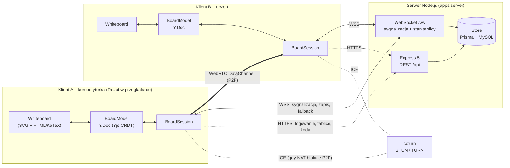

- **Monorepo** npm workspaces: `packages/shared`, `apps/server`, `apps/client`.
- Cały kod w **TypeScript** (strict). Kontrakt klient–serwer w `packages/shared` (`api.ts`, `signaling.ts`, `elements.ts`).
- Zmiany na tablicy płyną **bezpośrednio między uczestnikami (P2P)**; serwer równolegle utrwala stan
  i przekazuje zmiany tym, z którymi nie udało się zestawić P2P.

## 2. Model danych tablicy (CRDT)

Tablica to dokument **Yjs** (`Y.Doc`):

- `Y.Map elements` – `id → element` (obiekt JSON zgodny z `BoardElement` z `packages/shared/src/elements.ts`),
- `Y.Map meta` – ustawienia tablicy (np. tło),
- kolejność rysowania wyznacza pole `z` elementu.

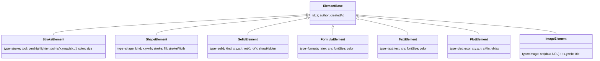

Rodzaje elementów: `stroke` (pióro/zakreślacz – punkty `[x, y, nacisk]`), `shape` (odcinek, strzałka,
prostokąt, elipsa, trójkąt, trójkąt prostokątny, romb, sześciokąt, układ współrzędnych), `solid` (sześcian,
prostopadłościan, ostrosłup, graniastosłup, czworościan, walec, stożek, kula – z kątami obrotu),
`formula` (LaTeX), `text`, `plot` (wykres funkcji), `image` (obraz: zdjęcie, zrzut ekranu, wzór CKE).

Yjs zapewnia **bezkonfliktowe scalanie** równoczesnych zmian (CRDT) – każdy uczestnik ma lokalną kopię,
zmiany są propagowane jako binarne aktualizacje i zbiegają się do tego samego stanu niezależnie od kolejności.
Cofanie/ponawianie (`Y.UndoManager`) dotyczy tylko zmian lokalnego użytkownika.

## 3. Synchronizacja i połączenia

### 3.1 Przebieg dołączenia i negocjacja WebRTC

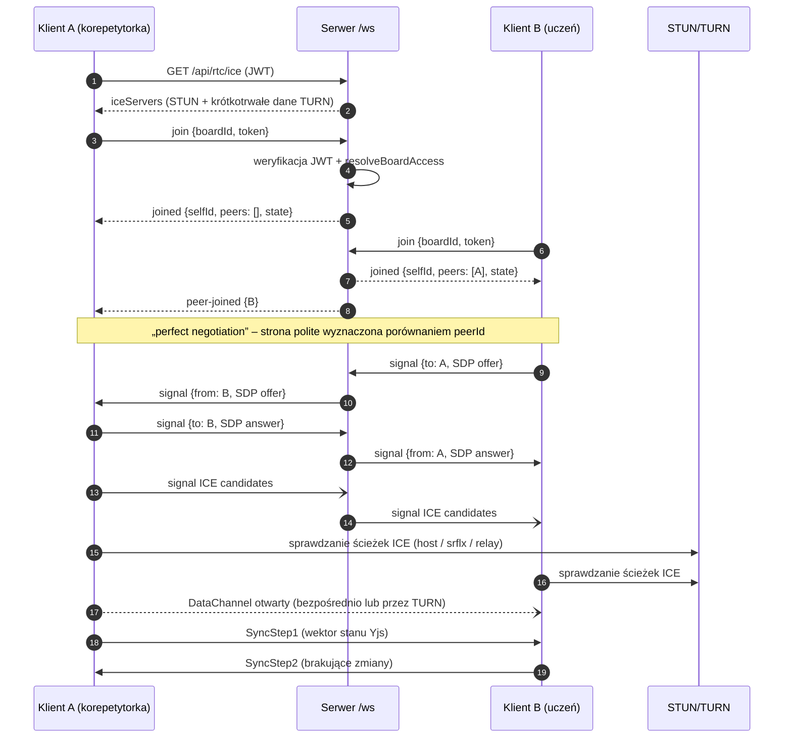

1. Klient otwiera WebSocket `/ws` i wysyła `join {boardId, token}`.
2. Serwer weryfikuje JWT i uprawnienia (`resolveBoardAccess`), ładuje stan tablicy (z bazy lub pamięci)
   i odsyła `joined {selfId, self, peers, state}`.
3. Klient stosuje stan z serwera; jeśli miał lokalne zmiany niewysłane (np. po zerwaniu połączenia),
   wysyła różnicę stanu.
4. Dla każdego obecnego uczestnika tworzony jest `PeerLink` (RTCPeerConnection + DataChannel).
   Negocjacja wg wzorca **„perfect negotiation”**, wiadomości SDP/ICE przekazuje serwer (`signal`).
5. Po otwarciu kanału uczestnicy wymieniają `SyncStep1` (wektor stanu) / `SyncStep2` (brakujące zmiany).

Stany połączenia z uczestnikiem (`PeerLink.state`, widoczne w pasku uczestników):

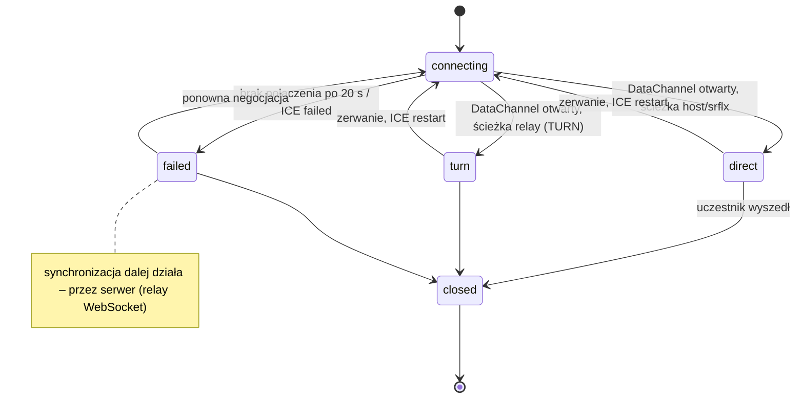

### 3.2 Propagacja zmian

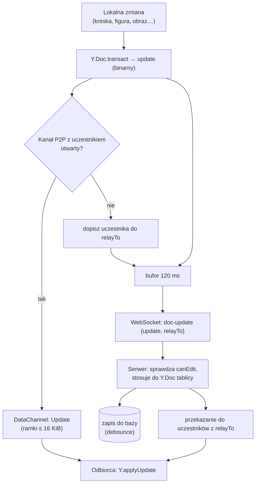

- Każda lokalna zmiana jest wysyłana **bezpośrednio P2P** do wszystkich otwartych kanałów (`Update`).
- Równolegle zmiany są **grupowane (120 ms)** i wysyłane do serwera (`doc-update`), który utrwala je
  w stanie tablicy. Pole `relayTo` zawiera uczestników, z którymi **nie ma** otwartego kanału P2P –
  serwer przekazuje im aktualizację (fallback, gdy NAT/firewall blokuje P2P i nie ma TURN).
- Dane **efemeryczne** (kursory, rysowana właśnie kreska) idą kanałem P2P jako JSON; dla uczestników bez
  kanału – przez serwer (`ephemeral`). Nie są zapisywane.
- Duże wiadomości binarne (np. obrazy) są dzielone na ramki ≤ 16 KiB (`sync/framing.ts`, `Reassembler`).

### 3.3 STUN / TURN

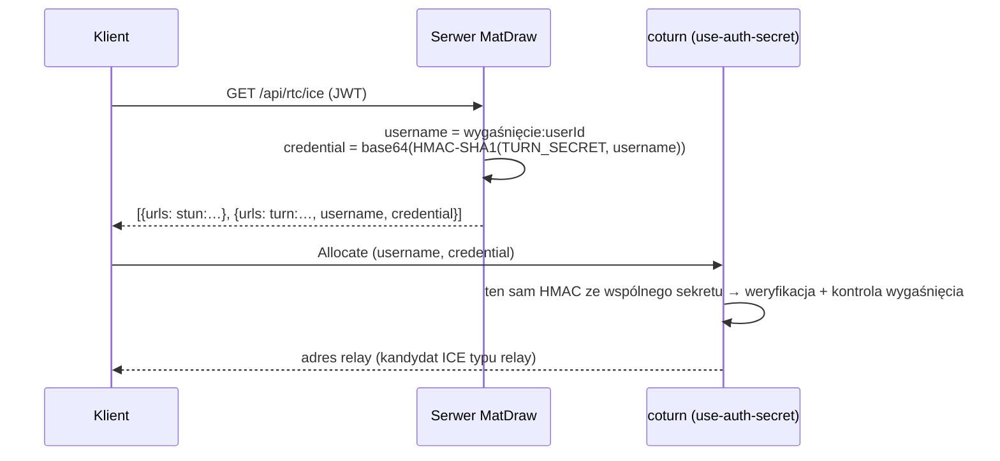

`GET /api/rtc/ice` zwraca listę serwerów ICE. Przy `TURN_SECRET` serwer generuje **krótkotrwałe
poświadczenia** zgodne z mechanizmem `use-auth-secret` coturn. Dzięki TURN połączenie działa między dowolnymi
sieciami (nie tylko w LAN) – również gdy obie strony są za restrykcyjnym NAT.

### 3.4 Uprawnienia w czasie rzeczywistym

- Uczestnik bez prawa edycji (`canEdit = false`): serwer odrzuca jego `doc-update` i rysowane na żywo kreski;
  klienci ignorują aktualizacje P2P od takiego uczestnika.
- Zmiana uprawnień / usunięcie / usunięcie tablicy (REST) powoduje natychmiastowe powiadomienie przez `Hub`:
  `peer-updated`, `kicked` (z rozłączeniem), `board-deleted`.
- Odnowienie połączenia: ping co 25 s, ponowne łączenie z wykładniczym opóźnieniem (do 15 s).

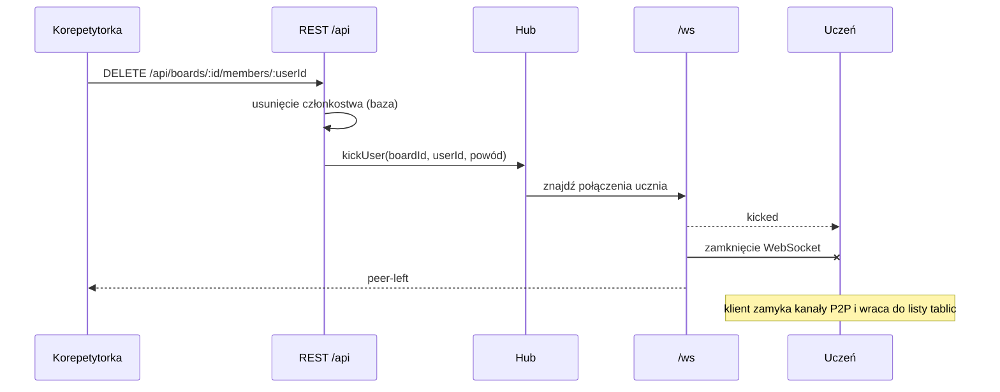

### 3.5 Kursory uczestników (jak w Figmie)

- Każda osoba na tablicy ma **kolor przydzielany przez serwer** przy dołączeniu (`pickPeerColor` w
  `packages/shared/src/signaling.ts`): korepetytorki – pula różowo‑fioletowa (pierwsza **różowa** `#e64980`),
  uczniowie – pula bez różu (pierwszy **niebieski** `#1c7ed6`, kolejni: zielony, pomarańczowy, fioletowy…).
  Kolor jest unikalny w obrębie tablicy.
- **Własny kursor** jest zawsze systemowo/CSS **biały z czarną obwódką** (strzałka przy zaznaczaniu, celownik
  przy rysowaniu) – swój kolor widzą tylko inni. Zdalny kursor to strzałka SVG w kolorze uczestnika
  z delikatnym cieniem (bez czarnej obwódki) i **etykietą z widoczną nazwą** (`displayName`) w tym samym kolorze,
  również z delikatnym cieniem i bez obwódki. Własny kursor nie jest
  nigdy rysowany jako zdalny, więc nie ma etykiety.
- Pozycja wysyłana jest jako `PeerEphemeral` `{t:'cursor', x, y, p}` w układzie współrzędnych tablicy
  (niezależna od powiększenia), maks. co 40 ms; `p` = `mouse` | `pen` | `touch`. Dotyk wysyła kursor tylko
  podczas rysowania jednym palcem (nie przy przesuwaniu/powiększaniu).
- **Znikanie:** mysz opuszczająca tablicę wysyła `cursor-hide` (kursor znika od razu). Pióro i dotyk
  zostawiają **ostatnią pozycję**; każdy kursor bez ruchu przez **5 s** (`CURSOR_IDLE_MS`) zanika (400 ms)
  i pojawia się przy następnym ruchu. Przeglądarka nie odróżnia trackpada od myszy (`pointerType = mouse`),
  więc reguła 5 s obowiązuje dla wszystkich wskaźników.

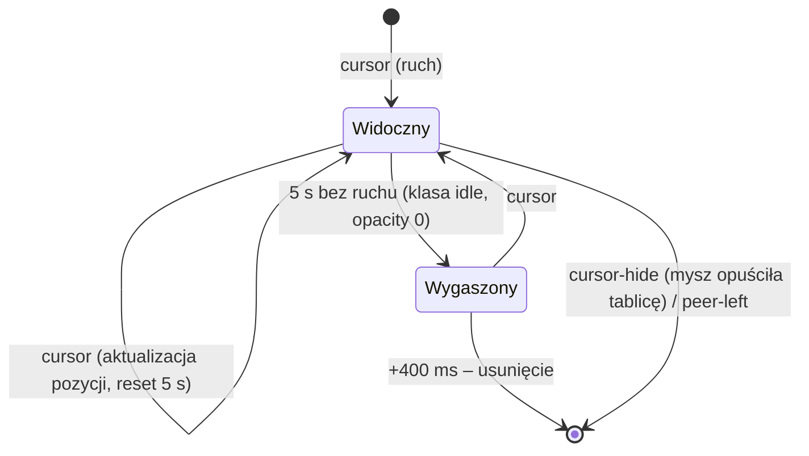

### 3.6 Diagnostyka połączeń i panel developera

Instrumentacja jest zawsze włączona i lekka (liczniki + bufor 200 zdarzeń):

| Warstwa | Co zbiera |
| --- | --- |
| `PeerLink` | stany `connectionState`/`iceConnectionState`/`iceGatheringState`/`signalingState`, kanał danych, czas zestawienia, restarty ICE, typy zebranych kandydatów, liczniki wiadomości/bajtów, `getStats()` → `summarizeStats` (wybrana para kandydatów, trasa host/srflx/relay, protokół do TURN, RTT, dostępne pasmo, DTLS) |
| `BoardSession` | stan WebSocket, RTT ping/pong, ponowne łączenia, bajty/wiadomości, ruch P2P vs przez serwer (zmiany dokumentu i dane efemeryczne), rozmiar dokumentu, serwery ICE (bez haseł), dziennik zdarzeń (`EventLog`) |
| `SignalingServer` | liczniki globalne (połączenia, dołączenia, wiadomości, bajty, przekazane sygnały, zapisane i przekazane zmiany, przekazane dane efemeryczne) i per uczestnik |

- **Na tablicy:** przycisk z ikoną pulsu lub `Ctrl+Shift+D` otwiera `ConnectionDebugPanel` – odświeżanie co 1 s,
  ping co 2 s, eksport raportu JSON do schowka. Dostępny dla obu ról.
- **`/dev` – Panel developera** (`pages/DevPage.tsx`, `sync/connectivityTests.ts`): środowisko przeglądarki,
  `/api/health`, test WebSocket (czas zestawienia, RTT), konfiguracja ICE, **test zbierania kandydatów**
  (host = LAN, srflx = STUN działa, relay = TURN działa) oraz **test pętli TURN** w dwóch etapach – dwa
  `RTCPeerConnection`, z których jeden ma `iceTransportPolicy: 'relay'`: (1) przekaźnik → zwykły klient,
  (2) przekaźnik ↔ przekaźnik (obie strony `relay`; wymaga coturn w sieci hosta). Korepetytorka widzi
  dodatkowo `GET /api/dev/stats` (odświeżanie co 3 s): proces, pamięć, konfiguracja TURN, liczniki
  sygnalizacji i aktywne tablice z uczestnikami.

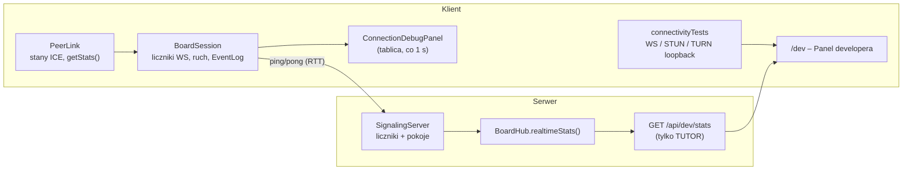

| Moduł                          | Rola                                                                                                         |
| ------------------------------ | ------------------------------------------------------------------------------------------------------------ |
| `config.ts`                    | Walidacja zmiennych środowiskowych (zod)                                                                     |
| `app.ts`                       | Express: helmet (CSP), CORS, JSON, rate‑limit, trasy, serwowanie klienta (SPA)                               |
| `auth/auth.ts`                 | bcrypt (hasła), JWT, middleware `requireAuth`, `requireRole`                                                 |
| `routes/*.ts`                  | REST: `auth`, `boards` (tablice, zaproszenia, członkowie, stan), `misc` (dołączanie kodem, ICE, użytkownicy) |
| `services/access.ts`           | Reguły dostępu do tablicy                                                                                    |
| `services/boardState.ts`       | Stan Y.Doc w pamięci z licznikiem referencji i opóźnionym zapisem (debounce) do bazy                         |
| `services/hub.ts`              | Most REST → WebSocket (powiadomienia o zmianach uprawnień)                                                   |
| `services/turn.ts`             | Generowanie konfiguracji ICE / poświadczeń TURN                                                              |
| `signaling/signalingServer.ts` | Serwer WebSocket: pokoje, sygnalizacja, aktualizacje dokumentu, przekazywanie (limit wiadomości 32 MB)       |
| `store/`                       | Interfejs `Store` + implementacje `PrismaStore` (MySQL) i `MemoryStore`                                      |
| `scripts/seed.ts`              | Dane początkowe: konto korepetytorki Weroniki Janeczek (idempotentnie)                                       |
| `scripts/createTutor.ts`       | Ręczne zakładanie kolejnych kont korepetytorów                                                               |

### 4.1 Model bazy danych (Prisma, MySQL)

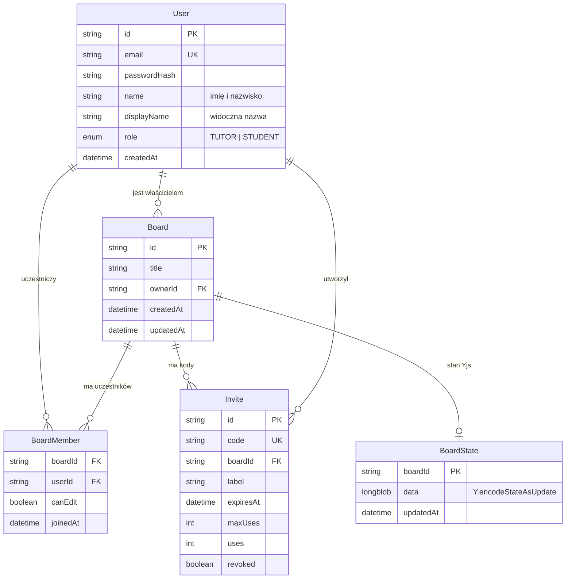

### 4.2 Reguły dostępu

- **Korepetytorka** (`TUTOR`) widzi i edytuje **wszystkie** tablice, tworzy/usuwa je, zarządza kodami
  i uczestnikami.
- **Uczeń** (`STUDENT`) widzi wyłącznie tablice, których jest członkiem; edycja zależna od `canEdit`.
- Kody zaproszeń: 8 znaków z alfabetu bez znaków mylących (31⁸ ≈ 8,5·10¹¹ kombinacji), generowane
  kryptograficznie (`crypto.randomInt`); limit prób dołączenia (rate‑limit 30 / 10 min).

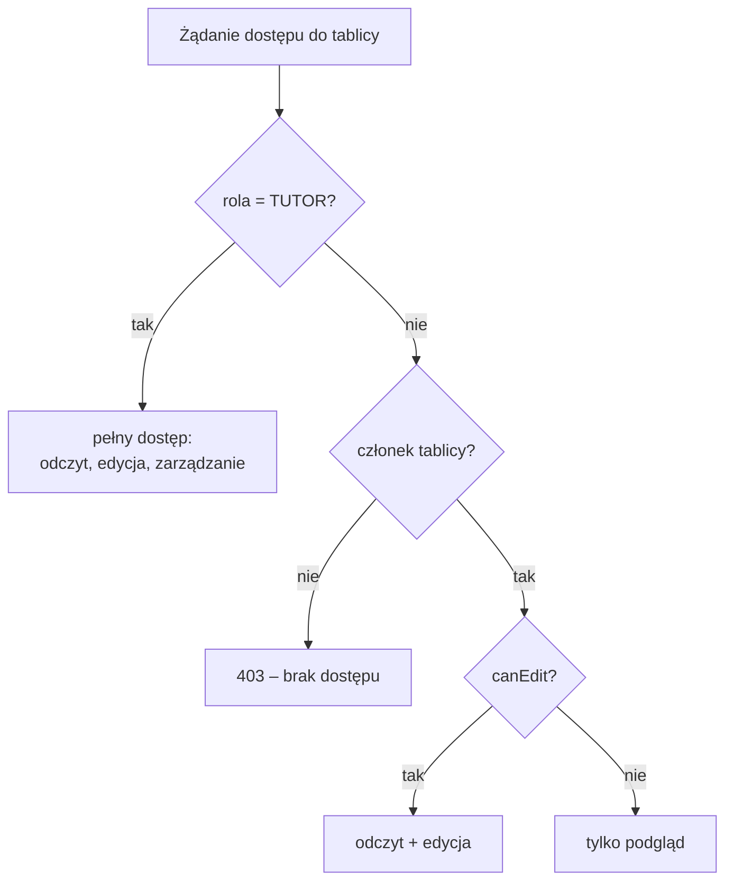

### 4.3 Bezpieczeństwo

- Hasła: bcrypt; tokeny JWT (domyślnie 7 dni); limity prób logowania/rejestracji/dołączania.
- Rejestracja korepetytorki wymaga sekretu `TUTOR_REGISTRATION_SECRET` (albo skryptu `create-tutor`).
- Walidacja wszystkich wejść (zod), limit rozmiaru wiadomości WebSocket, nagłówki bezpieczeństwa (helmet, CSP).
- Obrazy na tablicy są wyłącznie osadzonymi `data:image/...` (CSP `img-src 'self' data: blob:`); adresy
  zewnętrzne nie są wyświetlane (brak śledzenia przez obce serwery). SVG wyświetlany jest przez `<image>`,
  więc ewentualne skrypty w pliku SVG nie są wykonywane.
- Produkcyjnie wymagane **HTTPS/WSS** (WebRTC wymaga bezpiecznego kontekstu).
- Zmiana e‑maila/hasła (`PATCH /api/auth/me`) wymaga obecnego hasła; wcześniej wydane tokeny pozostają
  ważne do wygaśnięcia (świadome uproszczenie – brak wersjonowania tokenów).

## 5. Klient (`apps/client`)

| Moduł                                  | Rola                                                                                           |
| -------------------------------------- | ---------------------------------------------------------------------------------------------- |
| `config.ts`                            | Adres WebSocket (`/ws`) – ten sam origin co strona                                             |
| `api/`                                 | Klient REST, kontekst logowania (`AuthProvider`)                                               |
| `components/AppHeader.tsx`             | Wspólne menu nawigacyjne z ikonami, identyfikacją roli i wersją responsywną                    |
| `dialogs/FormulaDialog.tsx`             | Wzory wpisywane w MathLive, LaTeX lub rozpoznawane lokalnie z pisma odręcznego                 |
| `sync/session.ts`                      | `BoardSession` – WebSocket, Y.Doc, zarządzanie połączeniami P2P i fallbackiem                  |
| `sync/peerLink.ts`                     | `PeerLink` – RTCPeerConnection, perfect negotiation, kanał danych, wykrywanie TURN             |
| `sync/framing.ts`                      | Dzielenie i składanie ramek binarnych                                                          |
| `sync/diagnostics.ts`                  | Parsowanie kandydatów ICE, streszczenie `getStats()`, dziennik zdarzeń, formatowanie           |
| `sync/connectivityTests.ts`            | Testy dla `/dev`: WebSocket, zbieranie kandydatów STUN/TURN, pętla przez TURN                  |
| `components/ConnectionDebugPanel.tsx`  | Panel diagnostyki połączeń na tablicy (Ctrl+Shift+D)                                           |
| `pages/DevPage.tsx`                    | Panel developera `/dev`                                                                        |
| `board/model.ts`                       | `BoardModel` – operacje na elementach (transakcje, undo/redo)                                  |
| `board/Whiteboard.tsx`                 | Płótno: narzędzia, gesty, zaznaczanie, transformacje, kursory zdalne, wstawianie obrazów       |
| `board/render.tsx`                     | Renderowanie elementów (SVG: kreski, figury, bryły, wykresy, obrazy; HTML: KaTeX)              |
| `board/geometry.ts`, `board/solids.ts` | Geometria 2D, rzutowanie brył 3D z ukrywaniem krawędzi niewidocznych                           |
| `board/images.ts`                      | Wczytywanie, zmniejszanie i kompresja obrazów                                                  |
| `board/ColorPicker.tsx`, `board/color.ts` | Własne okno wyboru koloru (HSV, HEX, paleta, ostatnie kolory) i przeliczenia kolorów        |
| `cke/formulas.ts`                      | Zestaw wzorów maturalnych CKE (LaTeX, działy, tablica sin/cos/tg, wyszukiwanie)                |
| `cke/formulaInfo.ts`                   | Opisy wzorów: znaczenie, zastosowanie, przykład (tekst z wstawkami `$…$` renderowanymi KaTeX) |
| `cke/FormulaLibrary.tsx`               | Panel / strona wzorów z przeciąganiem na tablicę i rozwijanymi opisami                         |
| `cke/texToSvg.ts`                      | LaTeX → samodzielny obraz SVG (MathJax, ładowany leniwie)                                      |
| `math/expr.ts`                         | Bezpieczny parser wyrażeń do wykresów (bez `eval`)                                             |
| `recognition/`                         | Rozpoznawanie pisma (patrz niżej)                                                              |
| `components/Modal.tsx`, `components/dialogs.tsx` | Okno modalne (stos – Esc zamyka najwyższe) i `useDialogs()`: `confirm` / `prompt` w stylu aplikacji zamiast systemowych |
| `pages/`, `components/`, `dialogs/`    | Ekrany i okna dialogowe                                                                        |

### 5.1 Pióro, dotyk, nacisk

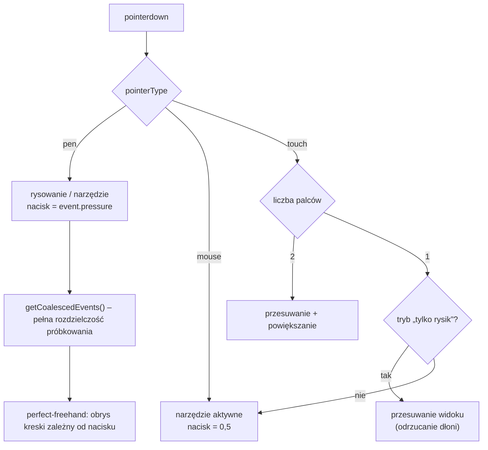

- **Pointer Events** z `getCoalescedEvents()` (wysoka rozdzielczość próbkowania pióra).
- Na powierzchni tablicy natywne `touchstart` i `touchmove` mają niepasywne listenery
  z `preventDefault()`, aby Safari nie przejmowało szybkich dotknięć Apple Pencil.
  Rysik ma pierwszeństwo przed rozpoczętym gestem dotykowym; dotyk podczas kontaktu rysika
  jest ignorowany. Po odłożeniu rysika nowe gesty palcami nadal przesuwają i powiększają widok.
  Utrata przechwycenia wskaźnika kończy gest, aby nie blokował kolejnej kreski.
- Nacisk (`pressure`) zapisywany dla pióra; dla myszy/palca stała grubość. Kształt kreski generuje
  `perfect-freehand` (wygładzanie, zwężanie końców).
- **Tryb „tylko rysik”** (palm rejection): pióro rysuje, palec przesuwa widok; włącza się automatycznie
  po pierwszym użyciu pióra.
- Gesty: dwa palce – przesuwanie i powiększanie; kółko myszy / gest touchpada; Safari `gesture*`.
- Własny kursor: przy zaznaczaniu strzałka SVG, przy narzędziach rysujących celownik SVG – oba **białe
  z czarną obwódką**, widoczne na jasnym i ciemnym tle (kursory pozostałych osób – patrz 3.5).

### 5.2 Renderowanie

Warstwy: tło (CSS – gładkie/kratka/kropki; starsza wartość `lines` jest odczytywana jako kratka) → warstwa HTML (wzory, tekst) → warstwa SVG (kreski, figury,
bryły, wykresy, obrazy) → kursory zdalnych uczestników. Transformacja widoku (`scale`, `ox`, `oy`) jest
wspólna dla warstw, dzięki czemu wzory KaTeX pozostają ostre przy dowolnym powiększeniu.

Skróty narzędzi są przypisane w `Whiteboard.tsx` i naśladują konwencje Miro (`V/H`, `P`, `S`, `R`, `O`,
`L`, `T`, `E`; bryły 3D: `B`). Ponowne wywołanie `S` / `B` (figury 2D / bryły 3D) cyklicznie przełącza
aktywny typ obiektu. Duplikat tablicy jest tworzony przez `POST /api/boards/:id/duplicate`:
serwer zapisuje nowy rekord i kopiuje binarny stan Yjs, bez członków i zaproszeń.

### 5.3 Bryły 3D

Bryły są opisane siatką wierzchołków i ścian w układzie: **x w prawo, y w górę, z w stronę patrzącego**.
Obrót: `rotY` (wokół osi pionowej), `rotX` (pochylenie; dodatnie = górna część bryły pochylona do patrzącego,
czyli widok **z góry**). Domyślnie `rotX = 0,35`, `rotY = −0,6` – klasyczny rysunek szkolny, w którym
krawędzie niewidoczne (przerywane) leżą **z tyłu i u dołu** bryły. Pochylenie jest ograniczone do ±90°.

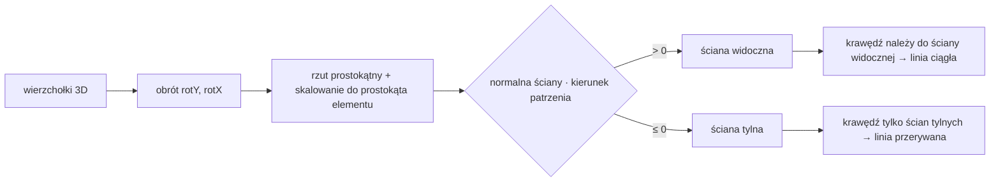

Krawędzie boczne brył obrotowych (walec, stożek) wyznaczane są jako tworzące styczne do konturu,
a niewidoczna połowa podstawy rysowana jest linią przerywaną.

### 5.4 Rozpoznawanie pisma

Rozpoznawanie działa **lokalnie** (bez usług chmurowych – darmowe API takie jak MyScript czy Mathpix
nie są dostępne bez opłat):

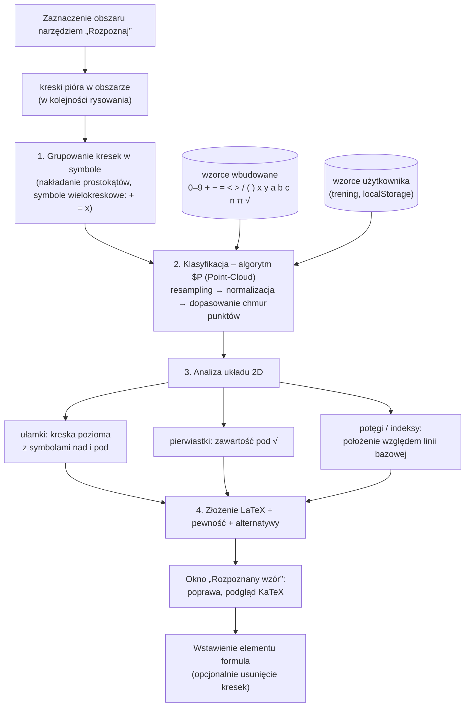

1. Grupowanie kresek w symbole (nakładanie się prostokątów otaczających, kreski wielokreskowe jak `+`, `=`, `x`).
2. Klasyfikacja symboli algorytmem **$P (Point‑Cloud Recognizer)** względem wzorców wbudowanych
   oraz **wzorców użytkownika** (trening).
3. Analiza układu 2D: **ułamki**, **pierwiastki**, **potęgi i indeksy**, mnożenie (`·`).
4. Wynik w LaTeX z oceną pewności dla każdego symbolu i alternatywami – użytkownik może poprawić przed wstawieniem.

### 5.5 Obrazy

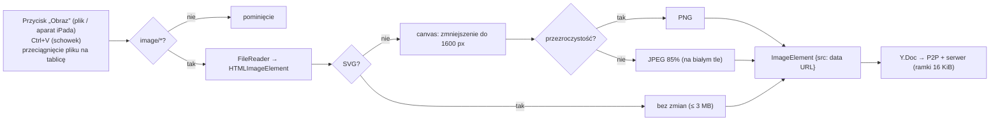

Obraz jest przechowywany w dokumencie tablicy jako `data:` URL (maks. ~3 MB po kompresji), więc
synchronizuje się i zapisuje tak samo jak inne elementy. Skalowanie zachowuje proporcje.

### 5.6 Wzory maturalne CKE

Zestaw wzorów (`cke/formulas.ts`) odpowiada układowi broszury CKE „Wybrane wzory matematyczne”
(15 działów, oznaczenie wzorów tylko dla poziomu rozszerzonego) i jest uzupełniony o dział 16 – tablicę
wartości sin/cos/tg dla 0°–90°, generowaną funkcją `trigTableRows` (4 miejsca po przecinku, przecinek
dziesiętny). Opisy wzorów (`cke/formulaInfo.ts`, klucz = `id` wzoru) są pokrywane testem – każdy wzór musi
mieć opis, a wszystkie wstawki `$…$` muszą renderować się w KaTeX. Panel jest dostępny na tablicy (przycisk
„Wzory maturalne CKE” – także w trybie tylko do podglądu) oraz jako osobna strona `/wzory`.

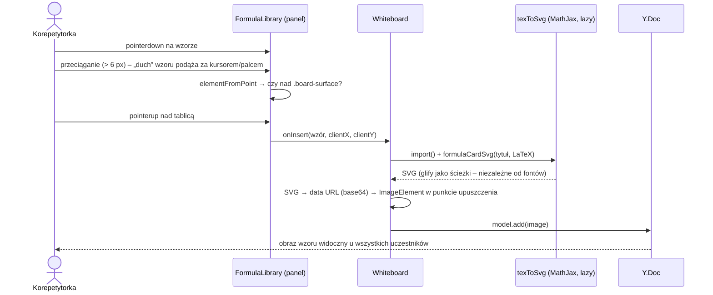

- Przeciąganie zrealizowano na **Pointer Events** (nie HTML5 Drag&Drop, które nie działa dotykiem na iPadzie);
  na ekranie dotykowym pionowy ruch palca przewija listę, a poziomy przeciąga wzór (`touch-action: pan-y`).
- Alternatywa: przycisk „+” wstawia wzór na środek widoku.
- Konwersja LaTeX → SVG wykonywana jest przez **MathJax** (`mathjax-full`, pakiety `base`, `ams`), moduł
  ładowany dopiero przy pierwszym wstawieniu. Glify są ścieżkami SVG, więc obraz wygląda identycznie na każdym
  urządzeniu.

### 5.7 Platformy

MatDraw jest **wyłącznie aplikacją webową** (bez PWA, Electron, Capacitor i innych pakietów natywnych).
Klient jest serwowany przez serwer pod tym samym originem co API i WebSocket, więc nie wymaga konfiguracji
adresu serwera ani CORS. Obsługiwane przeglądarki: Edge/Chrome (Windows 10/11), Safari/Chrome/Edge (macOS),
Safari (iPadOS). Pióro z siłą nacisku i dotyk działają przez Pointer Events. `main.tsx` wyrejestrowuje
Service Workera pozostałego po dawnej wersji PWA.

### 5.8 Konto użytkownika

Strona `/konto` (`pages/AccountPage.tsx`) jest wspólna dla obu ról i wywołuje `PATCH /api/auth/me`.
`name` to imię i nazwisko, `displayName` – nazwa widoczna dla innych (sygnalizacja `peer.name`, kursory,
lista uczestników, właściciel tablicy). Zmiana e‑maila lub hasła wymaga obecnego hasła; odpowiedź zawiera
nowy token i zaktualizowanego użytkownika.

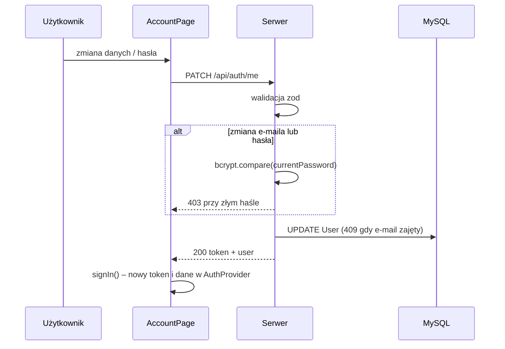

## 6. Wdrożenie (skrót)

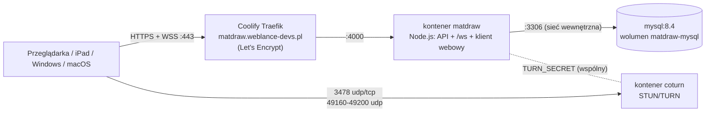

Szczegóły: [WDROZENIE.md](WDROZENIE.md).

## 7. Testy

- Serwer (`apps/server/tests`, vitest + supertest + ws): autoryzacja, reguły dostępu, zaproszenia,
  sygnalizacja, przekazywanie aktualizacji, wyrzucanie uczestników, kolory wg roli, `/api/dev/stats`.
- Klient (vitest): parser wyrażeń, bryły 3D (w tym położenie krawędzi niewidocznych), ramkowanie,
  rozpoznawanie pisma (syntetyczne wzory), **wszystkie wzory CKE** (poprawność w KaTeX i MathJax, eksport SVG),
  diagnostyka (parsowanie kandydatów, `summarizeStats`, maskowanie haseł TURN), przydział kolorów.
- E2E (ręcznie, Playwright): dwie izolowane sesje przeglądarki – synchronizacja P2P w obie strony, kursory,
  trwały zapis, wyrzucenie ucznia; wariant z zablokowanym P2P (fallback przez serwer); kolory i etykiety
  kursorów, wygaszanie po 5 s, panel diagnostyki i `/dev`.
