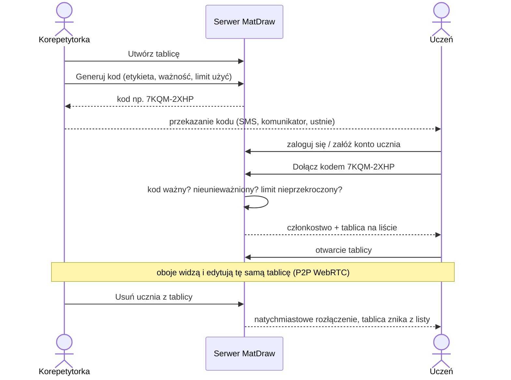
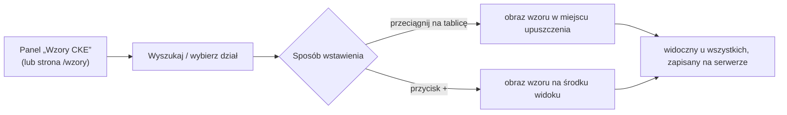

# MatDraw – opis funkcjonalny

## 1. Role i konta

| Funkcja | Korepetytorka (`TUTOR`) | Uczeń (`STUDENT`) |
|---|---|---|
| Rejestracja | z kodem rejestracyjnym korepetytorek lub przez administratora (skrypt) | swobodna |
| Lista tablic | **wszystkie** tablice | tylko tablice, do których dołączył / został dodany |
| Tworzenie, zmiana nazwy, usuwanie tablic | ✔ | ✘ |
| Generowanie kodów zaproszeń (wiele na tablicę) | ✔ | ✘ |
| Unieważnianie kodów | ✔ | ✘ |
| Dodawanie ucznia po adresie e‑mail | ✔ | ✘ |
| Usuwanie uczestników z tablicy | ✔ (natychmiastowe rozłączenie) | ✘ |
| Nadawanie / odbieranie prawa edycji | ✔ | ✘ |
| Dołączanie do tablicy kodem | ✔ | ✔ |
| Opuszczenie tablicy | — | ✔ |
| Rysowanie i edycja | ✔ zawsze | ✔ jeśli ma prawo edycji, inaczej tylko podgląd |
| Edycja własnego konta (widoczna nazwa, imię i nazwisko, e‑mail, hasło) | ✔ | ✔ |

### 1.1 Moje konto (`/konto`)

Każdy zalogowany użytkownik (korepetytorka i uczeń) może edytować własne dane:

| Pole | Zasady |
|---|---|
| Widoczna nazwa | 1–60 znaków; pokazywana innym na tablicy (kursor, lista uczestników, powiadomienia) i jako właściciel tablicy |
| Imię i nazwisko | 2–120 znaków; widoczne dla korepetytorki na liście uczestników |
| E‑mail (login) | unikalny; zmiana wymaga podania **obecnego hasła** |
| Hasło | min. 8 znaków; zmiana wymaga podania **obecnego hasła** i powtórzenia nowego |

Rola konta (korepetytorka / uczeń) jest widoczna na stronie, ale nie można jej zmienić.
Przy rejestracji widoczna nazwa jest opcjonalna – domyślnie równa imieniu i nazwisku.

## 2. Kody zaproszeń

- Korepetytorka generuje **dowolną liczbę kodów** dla tablicy (np. osobny dla każdego ucznia).
- Parametry kodu: **etykieta** (np. „Jan”), **ważność** (1 h, 24 h, 7 dni, 30 dni, bez limitu),
  **limit użyć** (1, 2, 5, 30, bez limitu).
- Kod ma 8 znaków (wyświetlany jako `XXXX-XXXX`), wielkość liter i myślnik nie mają znaczenia.
- Kod można **unieważnić** w każdej chwili – osoby, które już dołączyły, pozostają członkami
  (aby je usunąć, użyj listy uczestników).
- Uczeń wpisuje kod na stronie głównej → staje się członkiem tablicy i od razu ją widzi.

## 3. Współpraca w czasie rzeczywistym

- Dowolna liczba osób jednocześnie (projektowo 2–5; typowo korepetytorka + uczeń).
- Połączenie **bezpośrednie P2P (WebRTC)** między urządzeniami – w dowolnych sieciach (Internet, LAN),
  z serwerem **TURN** jako przekaźnikiem, gdy bezpośrednie połączenie jest niemożliwe.
- Gdy P2P nie działa w ogóle, zmiany automatycznie idą przez serwer – praca nie zostaje przerwana.
- Widoczne: lista uczestników z kolorami i stanem połączenia (bezpośrednie / przez TURN / przez serwer),
  **kursory** innych osób z imionami oraz **rysowane na żywo** kreski.

### 3.1 Kursory (jak w Figmie)

| | Korepetytorka widzi | Uczeń widzi |
|---|---|---|
| własny kursor | biały z czarną obwódką, **bez etykiety** | biały z czarną obwódką, **bez etykiety** |
| kursor drugiej osoby | **niebieski** (uczeń) z czarną obwódką + etykieta „Michał” | **różowy** (korepetytorka) z czarną obwódką + etykieta „Weronika” |

- Kolor przydziela serwer według roli: korepetytorka – różowy, pierwszy uczeń – niebieski, kolejni uczniowie
  – zielony, pomarańczowy, fioletowy… (zawsze różne kolory na jednej tablicy). Ten sam kolor ma obramowanie
  osoby na liście uczestników w nagłówku.
- Etykieta pokazuje **widoczną nazwę** z ustawień konta, w kolorze kursora.
- Mysz: kursor znika, gdy wskaźnik opuści tablicę. **Pióro, trackpad, dotyk:** widać ostatnią pozycję,
  a po **5 s bez ruchu** kursor płynnie znika i wraca przy następnym ruchu (ta sama reguła 5 s dotyczy
  także nieruchomej myszy, bo przeglądarka nie odróżnia trackpada od myszy).
- Na ekranie dotykowym kursor jest wysyłany podczas rysowania jednym palcem (nie przy przesuwaniu widoku).

### 3.2 Diagnostyka połączeń i panel developera

- **Na tablicy** (obie role): przycisk z ikoną pulsu w nagłówku lub `Ctrl+Shift+D` – panel na żywo
  (odświeżanie co 1 s): stan WebSocket i ping do serwera, dla każdej osoby trasa (**P2P bezpośrednio /
  przez TURN / przez serwer**), stany ICE, wybrana para kandydatów (adres, protokół, typ host/srflx/relay),
  RTT, pasmo, przesłane dane, ruch P2P vs przez serwer, serwery ICE, dziennik zdarzeń; przycisk
  „Kopiuj raport JSON” (do zgłoszenia problemu).
- **Panel developera** `/dev` (link „Diagnostyka” na liście tablic): testy przeglądarki, API, WebSocket,
  zbierania kandydatów (czy działa STUN i TURN) i **test pętli przez TURN** (czy przekaźnik faktycznie
  przenosi dane – do zwykłego klienta oraz między dwiema osobami, które obie łączą się przez TURN). Korepetytorka widzi też **statystyki serwera na żywo**: czas działania, pamięć,
  konfigurację TURN, liczniki sygnalizacji oraz aktywne tablice z osobami i ich ruchem.
- Równoczesna edycja tego samego miejsca jest bezkonfliktowa (CRDT).
- Utrata połączenia: aplikacja łączy się ponownie automatycznie, a zmiany wykonane w tym czasie
  są dosyłane po odzyskaniu połączenia.

## 4. Zapis

- Każda zmiana jest zapisywana **centralnie na serwerze** (MySQL) – po zamknięciu i ponownym otwarciu
  tablica wygląda tak samo, na każdym urządzeniu.
- Nie ma przycisku „Zapisz” – zapis jest automatyczny (opóźnienie ok. 2 s).

## 5. Narzędzia tablicy

| Narzędzie | Opis |
|---|---|
| Zaznaczanie (V) | Zaznaczanie kliknięciem lub prostokątem, przesuwanie, skalowanie (uchwyt), obracanie brył 3D, duplikowanie, kolejność, usuwanie |
| Przesuwanie widoku (H) | Przewijanie tablicy (również spacja + przeciągnięcie, dwa palce, kółko myszy) |
| Pióro (P) | Rysowanie z siłą nacisku, 3 grubości, 7 kolorów + dowolny |
| Zakreślacz | Półprzezroczysta gruba kreska |
| Gumka (E) | Usuwa całe kreski/elementy, których dotknie |
| Figury 2D | Odcinek, strzałka, prostokąt, elipsa, trójkąt, trójkąt prostokątny, romb, sześciokąt, układ współrzędnych; opcjonalne wypełnienie |
| Bryły 3D | Sześcian, prostopadłościan, ostrosłup, graniastosłup, czworościan, walec, stożek, kula; obrót uchwytem, krawędzie niewidoczne przerywane (wyłączalne) |
| Wzór | Edytor LaTeX z podglądem na żywo i paletą symboli (ułamki, potęgi, pierwiastki, litery greckie, relacje, całki, sumy, granice, macierze…) |
| Rozpoznaj pismo | Zaznacz prostokątem odręczny zapis → aplikacja proponuje wzór LaTeX do poprawienia i wstawienia |
| Tekst (T) | Zwykły tekst w wybranym rozmiarze i kolorze |
| Wykres funkcji | `y = f(x)` z zakresem osi; funkcje `sin cos tan asin acos atan sqrt abs ln log exp floor ceil`, stałe `pi`, `e`, potęgi `^` |
| Obraz | Wstawienie zdjęcia / grafiki z pliku (na iPadzie także z aparatu lub galerii), ze schowka (Ctrl+V) lub przeciągnięciem pliku na tablicę |
| Wzory CKE | Panel wzorów maturalnych – przeciągnięcie wzoru na tablicę wstawia go jako obraz |

Dodatkowo: cofnij/ponów (Ctrl+Z / Ctrl+Shift+Z), tło (gładkie, kratka, linie, kropki), wyczyść tablicę,
powiększenie 10–800 %, „pokaż całość”, tryb „tylko rysik”, wydruk (Ctrl+P).

## 6. Obrazy

- Formaty: PNG, JPEG, WebP, GIF (pierwsza klatka), SVG.
- Duże zdjęcia są automatycznie **zmniejszane** (dłuższy bok do 1600 px) i kompresowane
  (JPEG; PNG gdy obraz ma przezroczystość), aby tablica szybko się synchronizowała. Limit po kompresji ~3 MB.
- Obraz pojawia się w miejscu upuszczenia / na środku widoku, dopasowany do ekranu, i od razu jest zaznaczony.
- Można go przesuwać, skalować (z zachowaniem proporcji), duplikować, zmieniać kolejność i usuwać –
  jak każdy inny element. Widzą go wszyscy uczestnicy i jest zapisywany razem z tablicą.
- Wstawianie obrazów wymaga prawa edycji.

## 7. Wzory maturalne CKE

- Zestaw wzorów odpowiadający broszurze CKE **„Wybrane wzory matematyczne”** używanej na egzaminie
  maturalnym z matematyki – 15 działów (wartość bezwzględna, potęgi i pierwiastki, logarytmy, silnia i dwumian
  Newtona, wzory skróconego mnożenia, ciągi, funkcja liniowa i kwadratowa, trygonometria, planimetria,
  geometria analityczna, stereometria, kombinatoryka, rachunek prawdopodobieństwa, parametry danych
  statystycznych, granice i pochodne). Wzory tylko z poziomu rozszerzonego są oznaczone **„R”**.
- **Dostępne dla wszystkich** zalogowanych użytkowników (korepetytorka i uczeń):
  - na tablicy – przycisk **„Wzory maturalne CKE”** (ikona książki na lewym pasku) otwiera panel z boku tablicy,
  - jako osobna strona **„Wzory CKE”** (`/wzory`) – link na liście tablic, do przeglądania i nauki.
- Wyszukiwarka (bez względu na polskie znaki, np. „pole trojkata”, „delta”, „stozek”) i filtr poziomu
  (Wszystkie / Podstawowy / Tylko rozszerzony).
- **Przeciągnięcie** wzoru z panelu na tablicę (myszą, piórem lub palcem) wstawia go jako **obraz** –
  kartkę z nazwą wzoru i zapisem – w miejscu upuszczenia. Przycisk **„+”** wstawia wzór na środek widoku.
  Zastosowanie: podpowiedź dla ucznia, omówienie, jak korzystać ze wzoru.
- Uczeń z prawem tylko do podglądu może przeglądać wzory, ale nie wstawia ich na tablicę.

## 8. Rozpoznawanie pisma

- Rozpoznawane symbole wbudowane: cyfry `0–9`, `+ − = < > / ( )`, `x y a b c n`, `π`, `√`, mnożenie (kropka).
- Rozpoznawane struktury: ułamki (kreska ułamkowa), pierwiastki, potęgi i indeksy dolne.
- Wynik zawsze można **poprawić ręcznie** przed wstawieniem; symbole niepewne są wyróżnione.
- **Trening**: użytkownik może dodać własne próbki pisma dla każdego obsługiwanego symbolu,
  co poprawia skuteczność rozpoznawania jego charakteru pisma na danym urządzeniu.
- Działa **offline**, bez wysyłania danych do zewnętrznych usług.

## 9. Platformy i urządzenia wejściowe

MatDraw jest **aplikacją webową** (bez instalacji) – działa w aktualnych przeglądarkach pod adresem
<https://matdraw.weblance-devs.pl>. Pióro z siłą nacisku jest obsługiwane przez standard Pointer Events.

| Platforma | Przeglądarka | Urządzenia wejściowe |
|---|---|---|
| Windows 10/11 | Edge, Chrome | Surface Pen, Wacom – nacisk przez Windows Ink / Pointer Events, ekran dotykowy |
| macOS | Safari, Chrome, Edge | Tablety graficzne, gładzik (gesty powiększania), mysz |
| iPadOS | Safari (opcjonalnie skrót „Do ekranu początkowego”) | Apple Pencil (nacisk), gesty dwoma palcami |

## 10. Ograniczenia

- Rozpoznawanie pisma obejmuje podstawowy zakres zapisu szkolnego; złożone wyrażenia (całki, macierze)
  najlepiej wprowadzać edytorem wzorów.
- Połączenia P2P przez restrykcyjne sieci (firmowe/szkolne) wymagają skonfigurowanego serwera TURN;
  bez niego działa fallback przez serwer (nieco większe opóźnienie).
- Brak resetu zapomnianego hasła e‑mailem. Zmiana hasła nie wylogowuje innych otwartych sesji –
  wygasają one po czasie ważności tokenu (domyślnie 7 dni).

## 11. Autorzy i licencja

- Autorzy aplikacji: **Michał Kozieński** oraz **[Weblance.pl](https://weblance.pl)** (informacja w stopce
  aplikacji i na ekranie logowania).
- Oprogramowanie zastrzeżone – korzystać mogą **wyłącznie osoby autoryzowane przez twórców**
  (Weronika Janeczek i jej uczniowie). Pełna treść: [LICENSE](../LICENSE).
- Zestaw wzorów CKE został opracowany na podstawie publicznie dostępnej broszury CKE w celach edukacyjnych.